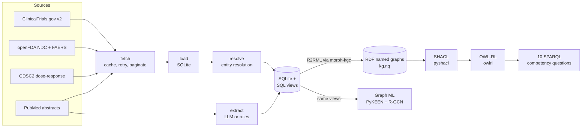

# biopharma-kg — an ontology-driven biomedical knowledge graph on real public data

Turns four public sources (**ClinicalTrials.gov, openFDA, GDSC2, PubMed**) into a validated, queryable RDF
knowledge graph and uses it for drug–condition / drug–sensitivity / drug–adverse-event link prediction.
It is built the way an enterprise data-integration project is built: sponsors are *business partners*, drugs are
*products*, trials and adverse-event reports are *transactions*, entity resolution is *master-data management*, SHACL
is the *data-quality layer*, and OWL-RL is the *business-rule layer*.

**No synthetic data is part of the project.** Everything is fetched from the public sources at run time. (Hand-written
fixtures and a synthetic graph exist **only inside `tests/`** to test code; they are never used for results.)



## Contents
[Quick start](#quick-start) · [What each stage does](#what-each-stage-does) · [Competency questions](#competency-questions) ·
[Graph ML](#graph-ml) · [Configuration](#configuration) · [What is verified (and what is not)](#what-is-verified-and-what-is-not) ·
[Limitations](#limitations) · [Repository layout](#repository-layout) · [Data & licences](#data--licences)

## Quick start

Requires Python **3.11–3.13**, internet access (to the four providers), and a **GDSC2 file** you download yourself
(see step 2). Run everything **from the repository root** (the CLI finds `configs/`, `mappings/`, `ontology/`… relative
to the current directory, or pass `--root`).

```bash
# 1. install
git clone <your-repo-url> biopharma-kg && cd biopharma-kg
python -m venv .venv && source .venv/bin/activate          # Windows: .venv\Scripts\activate
pip install -e ".[ml,llm,dev]"                              # core + graph ML + LLM extraction + tests
#   core only (no graph ML / LLM):  pip install -e ".[dev]"
#   smaller torch (CPU only):       pip install torch --index-url https://download.pytorch.org/whl/cpu   (run before the line above)

# 2. GDSC2 (required): download "GDSC2 fitted dose response" (.xlsx or .csv) from
#    https://www.cancerrxgene.org/downloads/bulk_download  and put it in  data/raw/gdsc/
mkdir -p data/raw/gdsc && cp ~/Downloads/GDSC2_fitted_dose_response_*.xlsx data/raw/gdsc/

# 3. optional keys (all optional; they raise rate limits / enable the LLM backend)
export ANTHROPIC_API_KEY=...      # enables the LLM extraction backend (otherwise the rules baseline runs, with a warning)
export NCBI_API_KEY=...  NCBI_EMAIL=you@example.org   # PubMed: 10 req/s instead of 3, and NCBI asks for a contact email
export OPENFDA_API_KEY=...        # openFDA higher limits

# 4. FIRST run this: it probes the 4 live APIs + GDSC2 file and runs a tiny end-to-end pipeline in data/smoke
biopharma-kg smoke

# 5. the real run (all stages; training time depends on your CPU, see "Graph ML")
biopharma-kg run-all
```

Run `pytest` (offline, no keys needed) to check the code itself: **75 tests** (core-only installs skip the ML tests).

Individual stages (all idempotent, each reads the previous stage's output):

```bash
biopharma-kg fetch          # data/raw/<source>/<drug>.json   (resumable; --force to refetch)
biopharma-kg load           # -> data/processed/biopharma.sqlite
biopharma-kg resolve        # -> reports/resolution_report.json
biopharma-kg extract        # --backend auto|llm|rules|both
biopharma-kg audit-extraction --n 50     # CSV sample for manual precision review
biopharma-kg build-kg       # R2RML -> data/processed/kg.nq
biopharma-kg validate       # SHACL -> reports/shacl_report.ttl, shacl_summary.json   (--strict: exit 1 on violations)
biopharma-kg reason         # OWL-RL -> data/processed/kg_inferred.nq, reports/reasoning_report.json
biopharma-kg query          # 10 competency questions -> reports/queries/*.csv
biopharma-kg ml             # -> reports/ml_results.{csv,md,json}     (--quick for 5 epochs)
biopharma-kg status         # what exists on disk
biopharma-kg rebase --iri https://your.org/kg/   # replace the placeholder namespace everywhere
```

`make install-ml`, `make test`, `make smoke`, `make run` are shortcuts.

If something fails on your machine, `biopharma-kg smoke` writes `reports/smoke_report.json` with a per-source diagnosis.

## What each stage does

| Stage | Implementation | Notes |
|---|---|---|
| **Ontology** | `ontology/biopharma.ttl` (OWL 2, Turtle): 15 classes, 31 object properties, 24 datatype properties | sub-property hierarchies (`associatedWith*`), inverse properties, transitive `bp:broaderType`, PROV-O for extraction provenance |
| **R2RML ETL** | `mappings/*.r2rml.ttl` executed by [morph-kgc](https://github.com/morph-kgc/morph-kgc) over SQLite views | one **named graph per source** (`…/graph/ctgov`, `gdsc`, `openfda-ndc`, `openfda-faers`, `pubmed`, `extraction`, `reference`, `ontology`, `inferred`) |
| **Entity resolution** | `src/biopharma_kg/resolve/` | deterministic and auditable: drug/organisation normalisation, longest-phrase alias matching, curated cancer-type hierarchy. Details and limits in [docs/DESIGN.md](docs/DESIGN.md) |
| **LLM extraction** | `src/biopharma_kg/extract/llm.py` (Anthropic API) + rules baseline | strict grounding: an extracted relation is **dropped** unless its evidence sentence appears verbatim in the abstract, the object appears in that sentence, and the drug is a known seed drug. Every assertion keeps PMID, evidence, extractor and model as provenance |
| **SHACL** | `shapes/biopharma-shapes.ttl`, pyshacl | `sh:Violation` = integrity the pipeline guarantees; `sh:Warning` = format expectations real registry data may break. `validate --strict` fails only on violations |
| **OWL-RL reasoning** | owlrl on resource triples; only `bp:` inferences are kept | skipped, loudly, above `kg.reasoning_max_triples` (default 250 000; see [Configuration](#configuration)) |
| **SPARQL** | `queries/cq01…cq10` | two queries (`cq02`, `cq09`) run **with and without** inference so the effect of reasoning is visible |
| **Graph ML** | PyKEEN + PyTorch Geometric | see [Graph ML](#graph-ml) |

### Why SQLite views in the middle?
The R2RML mappings **and** the ML exporter read the same SQL views, and a test asserts that the RDF edge sets equal
the ML edge sets for every relation. The graph you query and the graph you train on cannot drift apart.

## Competency questions

Run `biopharma-kg query`; one CSV per question lands in `reports/queries/`. Each `.rq` file's header states the
question and whether it needs inference (`none | required | compare`).

| # | Question | Inference |
|---|---|---|
| cq01 | Which organisations sponsor trials of drugs that also have GDSC2 sensitivity data? | – |
| cq02 | For which (drug, cancer-type group) is the drug both trialled and has sensitive GDSC2 cell lines? | compare |
| cq03 | Gap analysis: drugs trialled for a cancer-type group with **no** sensitive cell line in it | – |
| cq04 | Marketed products, pharmacologic classes and trial counts per drug | – |
| cq05 | Most-reported FAERS reactions for drugs in Phase 3 trials | – |
| cq06 | Literature-extracted drug–condition links with no registered trial | – |
| cq07 | Organisations ranked by breadth of investigated drugs | – |
| cq08 | Extraction provenance overview (extractor, model, counts) | – |
| cq09 | All drug–condition associations, registry + literature | compare |
| cq10 | Literature-extracted targets vs. GDSC putative targets | – |

## Graph ML

Link prediction (tail ranking) on the same graph the SPARQL layer sees, minus trial nodes (leakage control, below).

| Task | Target relation | Split |
|---|---|---|
| `drug_condition` | drug → condition it is **investigated for** | **temporal**: newest 20 % of first-seen trial dates are test |
| `drug_sensitivity` | drug → **sensitive** GDSC2 cell line | random |
| `drug_adverse_event` | drug → **reported** reaction (FAERS) | random |

Models: **PyKEEN TransE, RotatE, ComplEx** (embedding methods), a **PyG R-GCN + DistMult** (GNN), and a
**popularity baseline** you should always compare against. Metrics: filtered, type-constrained MRR / Hits@1/3/10,
mean over seeds (default 3) with standard deviation, in `reports/ml_results.md`.

Leakage controls (each has a test): no trial nodes in the graph; no inverse relations in training; time-aware context
edges for the temporal task; unseen-entity drop; a shortcut report; a hard `assert_no_leakage` before training. The
evaluator is checked against a brute-force implementation and PyKEEN's own evaluator. Details: [docs/DESIGN.md](docs/DESIGN.md).

**This repository contains no result numbers on purpose.** They depend on the live data on the day you run it. Run
`biopharma-kg ml` and read `reports/ml_results.md`. If a task has too little data it is **skipped with a reason**
(`skipped_tasks` in `reports/ml_results.json`), never silently shrunk. With the default 60 seed drugs some tasks may
be small, so raise `seed.max_drugs` for more data. Hyper-parameters were **not tuned on real data**.

## Configuration

Defaults live in `configs/default.yaml`; override any key with `biopharma-kg --config my.yaml <command>`. Notable keys:

| Key | Default | Meaning |
|---|---|---|
| `seed.max_drugs` | 60 | how many seed drugs hit the live APIs (GDSC2 drug names are used when the file is present) |
| `gdsc.required` | true | fail `fetch` if GDSC2 cannot be obtained |
| `gdsc.sensitive_quantile` | 0.25 | a pair is "sensitive" if its LN_IC50 is in the lowest 25 % for that drug (needs ≥ 10 responses) |
| `extraction.backend` | auto | `llm` if `ANTHROPIC_API_KEY` + SDK present, else `rules` (with a warning) |
| `extraction.model` | claude-sonnet-5-5 | Anthropic model id for the LLM backend |
| `kg.reasoning_max_triples` | 250000 | OWL-RL skip threshold. Measured in the dev sandbox on synthetic data: ≈0.5 ms and ≈4.5 KB per triple, linear (98 k triples → 53 s, 0.6 GB). Your machine will differ (`scripts/scale_check.py`) |
| `ml.models` / `ml.seeds` / `ml.epochs` / `ml.lr` | TransE, RotatE, ComplEx / 0,1,2 / 100 / 0.01 | |

## What is verified (and what is not)

I want to be explicit, because "it works" claims are cheap.

**Verified (automated, offline — `pytest`, 75 tests):**
* Every stage end to end — fetch → load → resolve → extract → R2RML → SHACL → OWL-RL → SPARQL → ML — run against
  **hand-written fixtures served by a local mock server** (`tests/fixtures/README.md` says what is invented).
* SPARQL answers (cq03) equal an independent SQL/Python computation, including a variant that creates real gaps.
* RDF edges equal ML edges for all 12 relations; SHACL conforms on the output **and fails on deliberately bad data**.
* The evaluator matches a brute-force reimplementation and PyKEEN's `RankBasedEvaluator`; training beats the
  popularity baseline on a *planted-structure synthetic* graph (a mechanics test, not a result).
* The LLM backend's grounding filters, caching and failure handling, using a fake client.
* The CLI as subprocesses, `rebase` (the rewritten copy still builds a valid graph), and the `smoke` command.
* Test environments: Python 3.13 (core + ML), 3.12 (core + ML), 3.11 (core only). Linux only.

**NOT verified — the development environment could not reach the live services:**
* The **live** ClinicalTrials.gov / openFDA / PubMed / GDSC endpoints. The connectors follow the providers'
  documentation and fail loudly on unexpected shapes, but I could not confirm today's live responses. **Run
  `biopharma-kg smoke` first** and open an issue with `reports/smoke_report.json` if anything fails.
* The GDSC2 auto-download URL (exact file name unverified; the manual download above is the reliable path) and a
  real GDSC2 file's exact columns (the reader matches columns flexibly and errors clearly if a required one is missing).
* A **live LLM call** (no API key in the dev environment). The SDK arguments were checked against the installed SDK
  (2.10.0) and the logic is tested with a fake client; real-model output quality and precision are unmeasured.
* Runtime and memory on real data, and any ML result on real data.
* Windows/macOS, GPU, GitHub Actions (`ci.yml` is untested), the CPU-only torch index.

## Limitations

* **Entity resolution is rule-based.** No fuzzy matching; corporate parents/subsidiaries are not merged; unmapped
  trial conditions stay unlinked to cancer types. Match rates are in `reports/resolution_report.json`.
* **FAERS counts are spontaneous reports, not incidence or risk**; GDSC "sensitive" is relative per drug; a trial is
  not evidence of efficacy. See [docs/DATA_SOURCES.md](docs/DATA_SOURCES.md).
* **Extraction precision is not measured** by this repo (use `audit-extraction`); LLM `confidence` is self-reported and
  uncalibrated; the rules baseline has no confidence.
* The seed set is a sample (default 60 drugs), so graph and ML results describe that sample, not "all of oncology".
* The namespace `https://biopharma-kg.example/` is a placeholder; use `biopharma-kg rebase` for a real one.
* Not medical software; outputs must not guide clinical decisions.
* Federated SPARQL, a triple store (GraphDB/Fuseki) and Ontop-style virtual graphs are intentionally out of scope:
  everything runs with `pip install` and no services.

## Repository layout

```
configs/        default.yaml, seed_drugs.txt
ontology/       biopharma.ttl
mappings/       R2RML mappings (one file per source)
shapes/         SHACL shapes
queries/        cq01–cq10 SPARQL + README
src/biopharma_kg/
  ingest/       HTTP client (retry/cache/throttle), ClinicalTrials.gov, openFDA, PubMed, GDSC2 connectors
  resolve/      name normalisation, phrase index, entity resolution
  extract/      rules baseline, LLM extractor, runner, audit sample
  kg/           R2RML build, SHACL, OWL-RL, SPARQL runner
  ml/           task construction (leakage-safe), evaluator, models (PyKEEN, R-GCN), runner
  db.py load.py pipeline.py smoke.py cli.py config.py
tests/          unit, pipeline, extraction, ML, CLI, smoke tests + fixtures (invented, test-only)
scripts/        scale_check.py
docs/           DESIGN.md, DATA_SOURCES.md
```

## Data & licences

Code, ontology, mappings, shapes and queries: MIT (see `LICENSE`). **No third-party data is redistributed**; `data/` and
`reports/` are git-ignored. GDSC2 and PubMed abstracts are subject to their providers' terms: download GDSC2 yourself
and see [docs/DATA_SOURCES.md](docs/DATA_SOURCES.md). If you use GDSC2, cite the GDSC resource as its terms ask.
